<p align="center">
  <a href="https://github.com/abhjz/the-training-grounds/actions/workflows/check.yml"></a>
  <a href="https://github.com/abhjz/the-training-grounds/releases/latest"></a>
  <a href="LICENSE.md"></a>
</p>

<p align="center">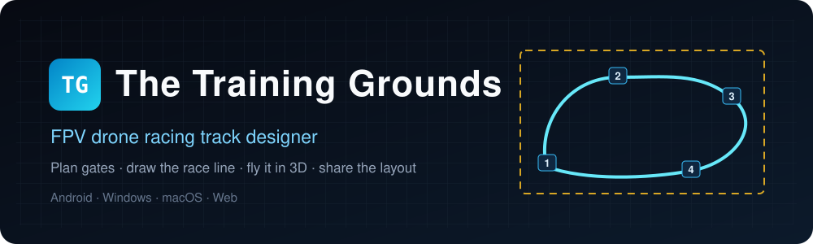</p>

# 🏁 The Training Grounds

**Design an FPV drone racing track, draw the race line, and fly through it in 3D before a single gate leaves the van.**

Place real gates and flags on a field drawn to scale, see the distance between every gate, get a lap-time estimate, and share the finished layout with your club as one small file. Model the whole flying site too: turf, sand, dirt track, trees, buildings and obstacles. Then fly it from five camera views and export the lap as a smooth video. It works on your phone at the field and on your laptop at home.

The app opens on **Main UAE FPV**, the UAE FPV Community's main site, built from a drone GPS survey.

Free for pilots & clubs · Android · Windows · macOS · works offline

---

## ⬇️ Download

| Your device | Download | Notes |
|---|---|---|
| 🤖 **Android** (phone / tablet) | [**TrainingGrounds-Android.apk**](https://github.com/abhjz/the-training-grounds/releases/latest/download/TrainingGrounds-Android.apk) | Android 7 or newer |
| 🪟 **Windows** — installer | [**TrainingGrounds-Windows-Setup.exe**](https://github.com/abhjz/the-training-grounds/releases/latest/download/TrainingGrounds-Windows-Setup.exe) | Windows 10 / 11, 64-bit. Adds a Start-menu shortcut |
| 🪟 **Windows** — portable | [**TrainingGrounds-Windows-Portable.exe**](https://github.com/abhjz/the-training-grounds/releases/latest/download/TrainingGrounds-Windows-Portable.exe) | No install — run it from anywhere, even a USB stick |
| 🍎 **Mac** — Apple Silicon (M1–M4) | [**TrainingGrounds-Mac-AppleSilicon.dmg**](https://github.com/abhjz/the-training-grounds/releases/latest/download/TrainingGrounds-Mac-AppleSilicon.dmg) | macOS 12 or newer |
| 🍎 **Mac** — Intel | [**TrainingGrounds-Mac-Intel.dmg**](https://github.com/abhjz/the-training-grounds/releases/latest/download/TrainingGrounds-Mac-Intel.dmg) | macOS 12 or newer |
| 📱 iPhone / iPad | — | Not available yet |

All versions and release notes: **[Releases](https://github.com/abhjz/the-training-grounds/releases)** · [Check your download is genuine](#-check-your-download-is-genuine)

> **Which Mac do I have?** Apple menu  → **About This Mac**. "Chip: Apple M…" → Apple Silicon. "Processor: Intel" → Intel.

---

## 📸 A look inside

<p align="center">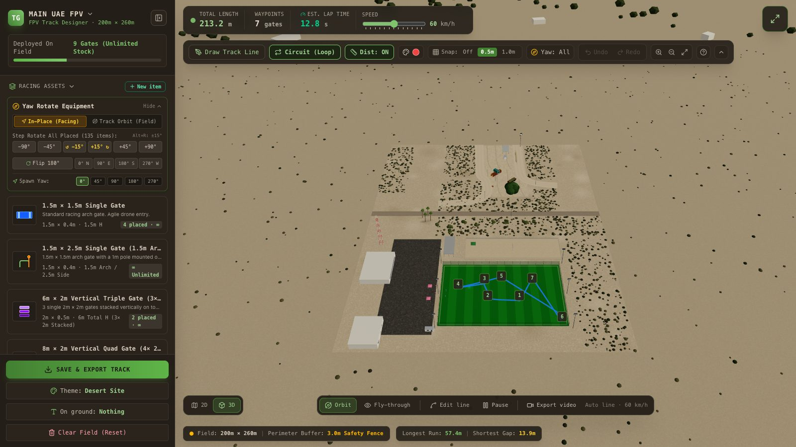</p>

| 🏜️ The whole site — track, obstacles, trees, buildings | 🌳 Environment assets — trees, grass, ground, buildings |
|:--:|:--:|
| 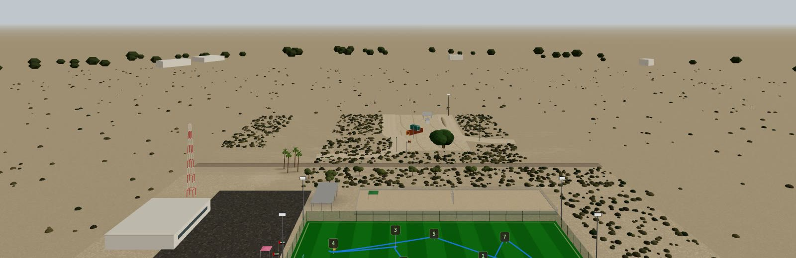 | 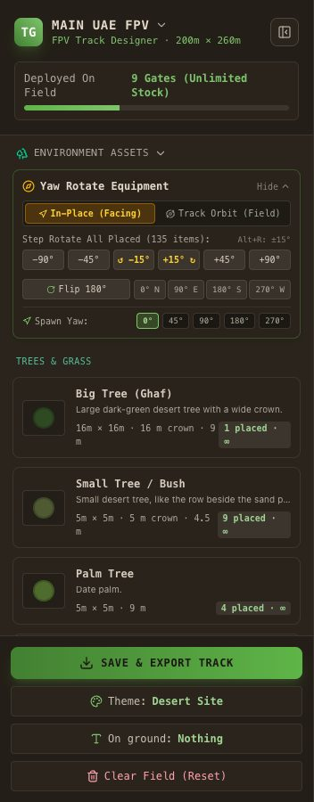 |
| 💡 **LED lights** — neon on gates, buildings, trees and poles | 🎯 **Nine-gate track** in the Normal look |
| 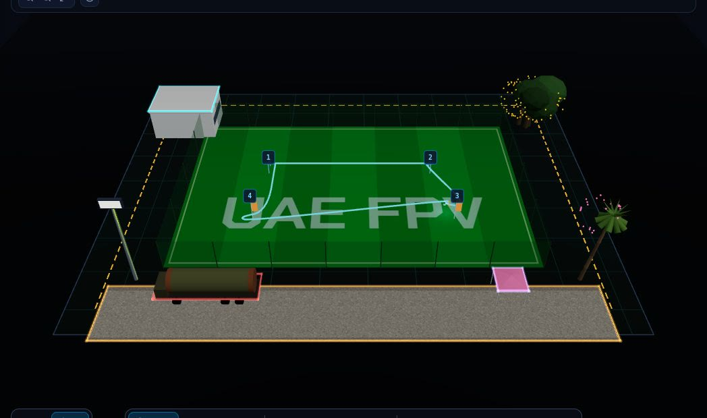 | 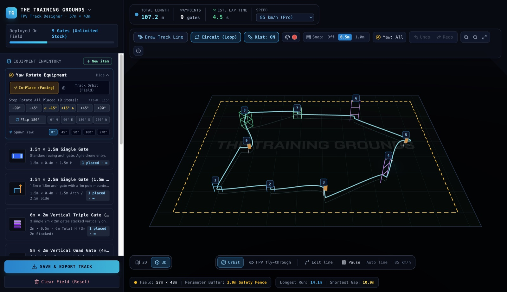 |

| 🗺️ 2D editor — exact metres, every gap measured | 🎥 FPV fly-through — see it from the quad |
|:--:|:--:|
| 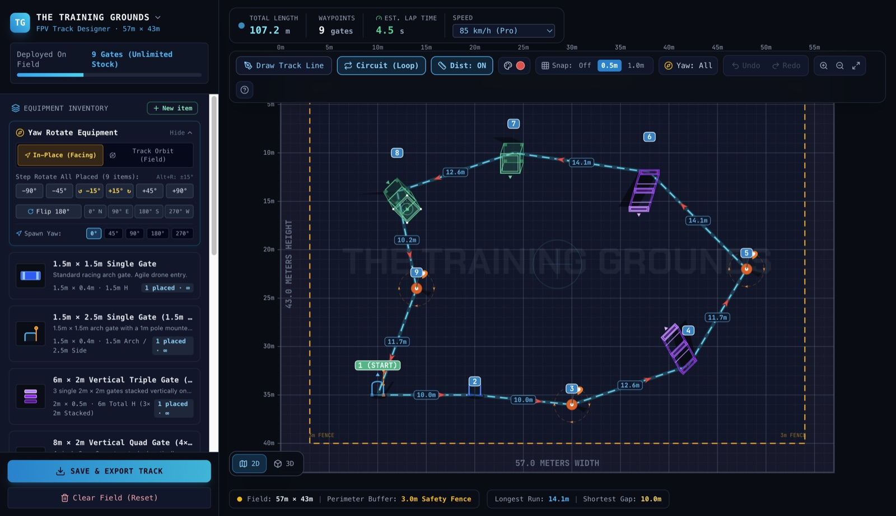 | 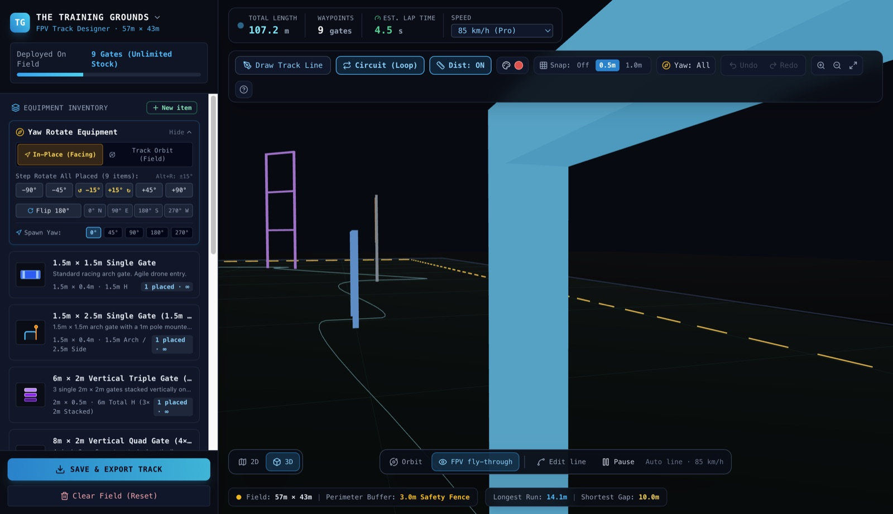 |
| ✏️ **Race line editor** — shape the line in 3D, gates stay put | 💾 **Save & share** — name it, export it, send it |
|  |  |

### 📱 Made for the phone too

| 3D field | Equipment drawer | 2D + tools | Landscape |
|:--:|:--:|:--:|:--:|
|  |  |  |  |


### 🌊 Six looks

Open **Theme** in the sidebar and pick a look. Your choice is remembered.

- **Desert Site** (the default). Real desert colours sampled from drone photos: sand, olive scrub, turf green, asphalt grey and a hazy morning sky. In 3D the desert runs to the horizon with scattered scrub, a far tree line and low white buildings.
- **Normal look.** The flat, technical editor, in any of the colour themes below.
- **Animated look.** Rounded, game-style buttons with an amber glow. The field is a mossy wooden deck; in 3D it sits on the roof of a drowned tower in a sunken city, with light shafts, kelp, coral, fish, jellyfish and rising bubbles.
- **Coastal Sunset.** A tropical ocean drive at golden hour: pastel art deco hotels with neon signs, palms, street lamps, cruising cars, speedboats, a helicopter and glittering water under a pink and gold sky.
- **Showroom.** Radical subtraction: white surfaces, grey text, one electric blue for the main action, no shadows or gradients. In 3D the field is polished concrete that reflects the gates, under a hazy city sky.
- **Trading Floor.** A near-black trading-platform style with one yellow for the main action, flat cards and green / red signals. In 3D, candlestick columns rise and fall around the field.

| Animated look (3D) | Animated look (FPV) | Coastal Sunset (FPV) |
|:--:|:--:|:--:|
| 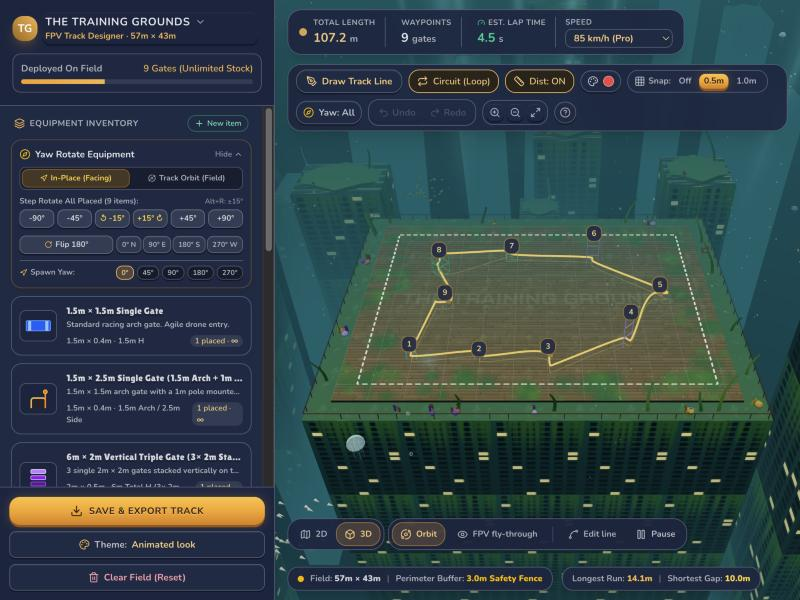 | 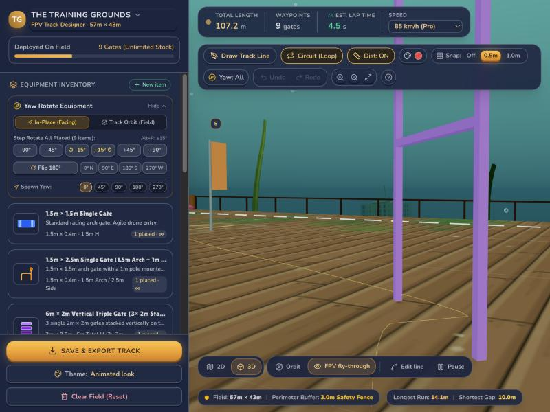 | 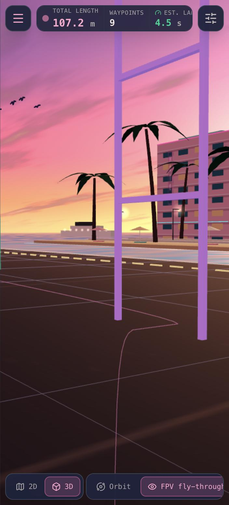 |

The scenery is decoration only: it ignores clicks, stops moving when your device asks for reduced motion, and is left out of 3D model exports.

### 🎨 Eleven colour themes

Each colour theme follows a 60 · 30 · 10 palette: 60% background, 30% text, and a 10% accent for buttons and the race line.

| Petrol Gaming | Sky Fresh (light) |
|:--:|:--:|
| 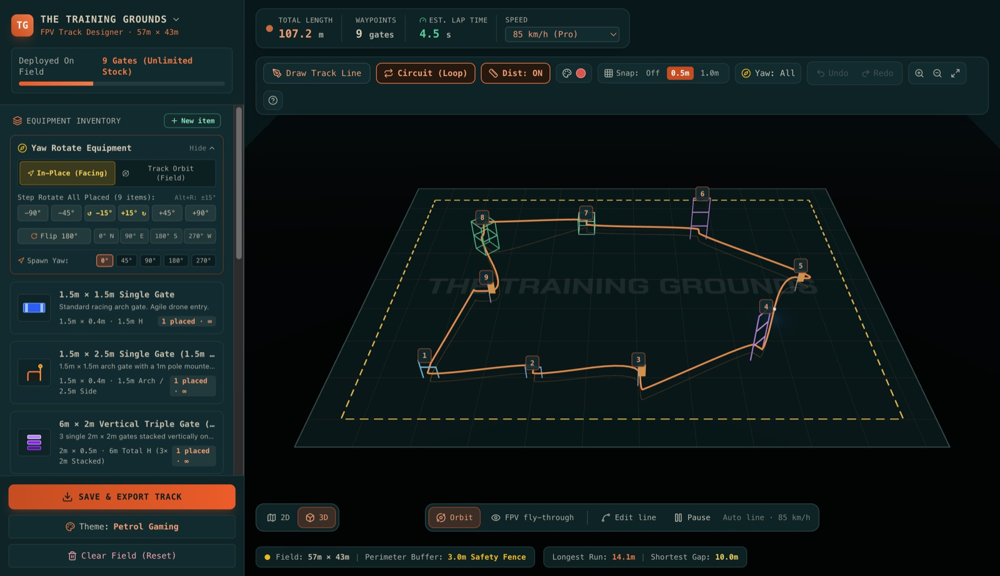 | 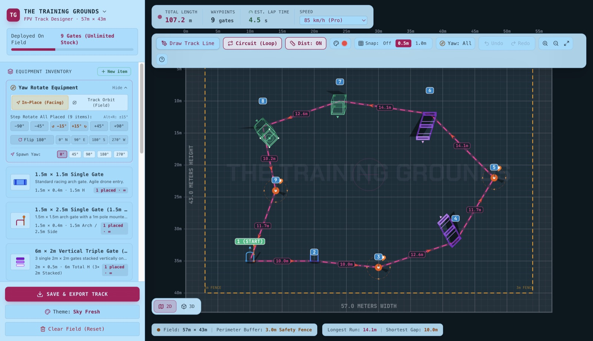 |
| **Midnight Neon** | **Mauve Loud** |
| 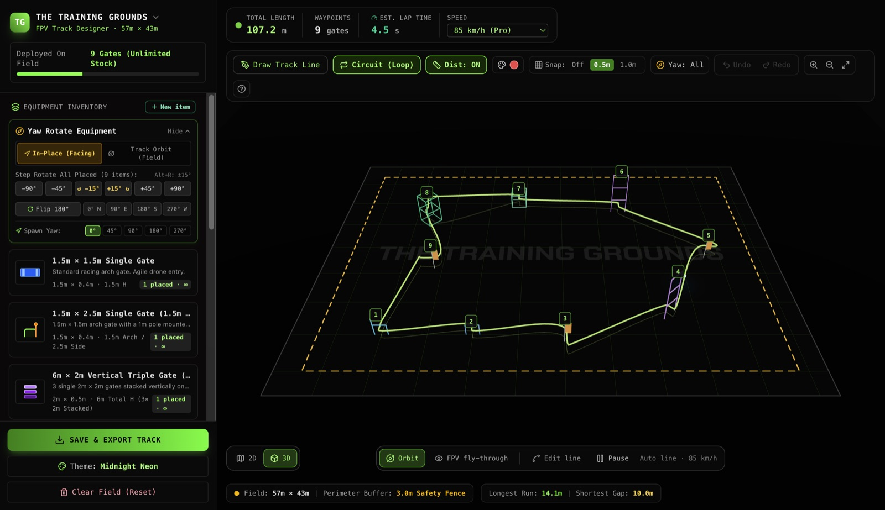 | 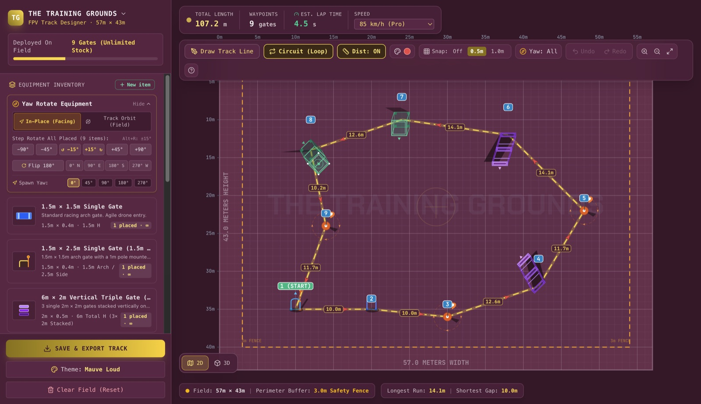 |

<p align="center">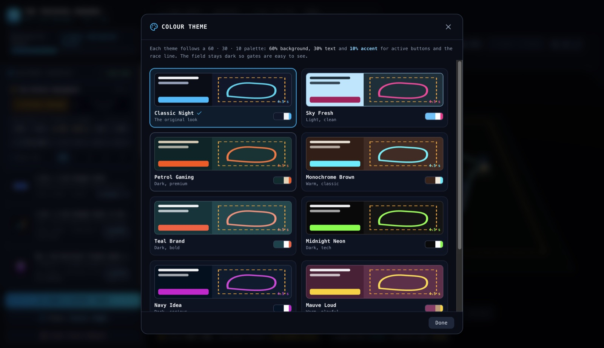</p>

---

## ✨ Features

### 🗺️ Build the track
- **A field drawn to scale.** Start on **Main UAE FPV** (200 × 260 m) or the classic 57 × 43 m field with a 3 m safety fence, and add your own grounds from 15 m up to 300 m. Each ground keeps its own layout.
- **Racing assets.** Pick from 1.5 m single gates, arch gates with a side pole, round hoops, 2 m cube gates, double cubes, vertical triple and quad ladders, 3 m flag poles, 20 ft containers, a launch pad and a pilot pit. Stock is unlimited.
- **Environment assets.** Switch the list to **Environment Assets** for trees, palms, grass and desert scrub; turf pitches, sand pits, asphalt, gravel roads, dirt track pieces and berms; buildings, cabins, sheds, shelters and gazebos; floodlights, light poles, a lattice mast and flagpoles; containers, wrecks, tyres and cable drums.
- **Any size.** Every piece can be resized: width, length and height, or crown size for trees and diameter for hoops. The race line follows a bigger gate.
- **Raise anything.** Lift a piece up to 12 m off the ground, for a gate on a stack or a roof.
- **LED lights.** Switch on neon lights in eight colours: frames light up on gates, roof edges on buildings, fairy lights in trees, tubes up poles.
- **Logos.** Put a logo on a flag, on each wall of a container (inside and out) and on its roof, or a national flag on a flagpole.
- **Your own equipment.** Use **＋ New item** to add any gate or obstacle you own with its real size.
- **Placing pieces.** Tap the field to place, drag to move, and snap to 0.5 m or 1 m.
- **Rotating pieces.** Yaw in 15° steps, pitch and roll, mirror, and set the angle new pieces spawn at. You can rotate every piece at once, either in place or around the field.
- **Locking.** Lock a piece so it can't be moved by accident.
- **One control at a time.** Selecting a piece opens a small panel with a **Control** list: position, size, elevation, heading, tilt, LED, logos, maneuver or waypoint order.
- **Ground marking.** Paint the ground name, your own text or a logo anywhere on the field, at any size and angle.
- **Ready-made layouts.** Start from a pro preset: Championship Qualifier, High-Speed Sweeper & Slalom, or Precision Cube & Technical Loop.

### 🛤️ Plan the line
- **Gate order.** Number the gates and the path joins them in sequence, with the distance of every leg shown.
- **Draw the line yourself.** Use **Draw Track Line** to trace your own line with your finger or mouse, then smooth it or build a curve through the gates automatically.
- **Circuit or open track.** Loop back to the start, or finish at the last gate.
- **Maneuvers on every gate.** Mark corkscrews, slaloms, dives, Split-S, ladders up and down, or orbiting a pole and exiting. The line flies them at real scale.
- **Race line editor in 3D.** Drag points, **Shift + drag** to change height (up to 15 m), and click a flag or gate to send the line around or through it. Gates stay fixed while you edit, so a stray tap can't move them.

### ⏱️ Know the numbers
- **Live figures.** Total length, gate count, longest straight and shortest gap update as you work.
- **Lap-time estimate.** Set the speed on a slider from **0 to 120 km/h** in steps of 10.

### 🎥 See it before you build it
- **3D field.** Orbit around the layout with gates at their real heights.
- **Fly-through in five views.** Ride the line as **FPV** (banking into turns), **Chase**, **Above**, **Side** or **Spectator**. Press **V** to switch.
- **FPV lens.** Set the camera from a normal lens to a 150° wide angle, and zoom any view in or out with the wheel, a pinch or **+ / −**.
- **Export video.** Export one lap as a smooth 60 fps MP4 (30 fps on Android), in the view, lens and speed you chose.
- **Full screen.** One button (or **F**) hides everything but the map; press it again or **Esc** to bring it all back. The sidebar and tools bar can also be hidden on their own.
- **Calm scenery.** Stop the 3D scenery moving (water, palms, birds) with one switch; the drone keeps flying.

### 💾 Save, share, export
- **Saved tracks.** Name a track and save it. It **remembers the field size**, so it always reopens on the right ground.
- **Track file (.json).** Send it to other pilots and open it on any phone or computer. On Android you can tap a track file in WhatsApp or Files and choose **Open with Training Grounds**.
- **High-res field map (.png).** A top-down plan with grid, gates, path and stats, ready for a briefing or a printout.
- **3D model (.glb).** The field, gates and race line, which open in Blender and any glTF viewer.
- **3D picture (.png).** The 3D view from your current camera angle.
- **Undo / redo and autosave.** Your work is kept even if you close the app.
- **Safe delete.** Deleting a saved track asks you to type **DELETE** first.

### 🎨 Make it yours
- **Six looks.** Desert Site (the default), Normal, Showroom (white and minimal), Trading Floor (near-black and yellow), and two animated ones with their own 3D scenery: a sunken city and a coastal sunset.
- **Eleven colour themes.** Classic Night, Sky Fresh, Petrol Gaming, Monochrome Brown, Teal Brand, Midnight Neon, Navy Idea, Mauve Loud, Olive Standout, Brick Hook and Coastal Sunset, with a live preview of each.
- **Readable in every theme.** Every text colour is contrast-checked against its background, so labels stay legible even on bold palettes.
- **The field stays dark.** The turf is tinted with the theme colour, so gates and the race line always stand out.
- **Your choice is remembered** between launches.

### 📱 Works where you are
- **Phones and tablets.** The equipment panel becomes a slide-in drawer and the tools fold into one button. Pinch to zoom and two-finger drag to pan in 2D.
- **Desktop.** You get the full layout plus keyboard shortcuts. Click the **?** button in the toolbar to see them.
- **No internet needed.** Everything stays on your device, with no accounts and no tracking.

---

## 🚀 Install

<details>
<summary><b>🤖 Android</b></summary>

1. Download **TrainingGrounds-Android.apk** on your phone, or send it to yourself by WhatsApp, Drive or email.
2. Tap the file. If Android asks, allow **Install unknown apps** for the app you opened it with (Files, Chrome, Drive…).
3. Tap **Install**, then open **Training Grounds**.

To update, install the new APK over the old one. Your saved tracks stay.
</details>

<details>
<summary><b>🪟 Windows</b></summary>

1. Download the **Setup** (installs with a Start-menu shortcut) or the **Portable** version (no install).
2. Run it. Windows may show **"Windows protected your PC"** because the app isn't code-signed yet. Click **More info → Run anyway**. This only happens the first time.
</details>

<details>
<summary><b>🍎 macOS</b></summary>

1. Download the **.dmg** for your Mac (Apple Silicon or Intel), open it and drag **Training Grounds** to **Applications**.
2. The app isn't notarized by Apple yet, so the first time macOS will block it:
   - Try to open it once, then go to **System Settings → Privacy & Security** and click **Open Anyway**.
   - If macOS says the app **"is damaged"**, run this once in Terminal (it only removes the download flag):
     ```bash
     xattr -cr "/Applications/Training Grounds.app"
     ```
</details>

### 🔐 Check your download is genuine

Every release lists a **SHA-256 checksum** for each file (in the release notes and in `SHA256SUMS.txt`). If your file's checksum matches, it's exactly the file published here and nobody has changed it.

- **Mac:** open Terminal and run `shasum -a 256 ~/Downloads/TrainingGrounds-Mac-AppleSilicon.dmg`
- **Windows:** open PowerShell and run `Get-FileHash $HOME\Downloads\TrainingGrounds-Windows-Setup.exe`
- **Android:** every official APK is signed with the same certificate. Its SHA-256 fingerprint is
  `49:45:F3:FC:DD:82:A8:96:BF:FD:5A:2D:9C:9F:3D:B7:EE:55:A1:F9:1D:B1:7F:2D:DE:48:73:FA:66:6C:C2:C8`

Only download the apps from this page. Copies posted anywhere else may have been changed.

---

## 🔄 Moving tracks between devices

1. Open **☰ → Save & Export Track → Track JSON File**. On a phone this opens the share sheet; on a computer it saves the file.
2. Send the file any way you like: WhatsApp, AirDrop, email, USB or Drive.
3. On the other device, open **Save & Export Track → Upload & Load Track JSON File**, or on Android just tap the file and choose **Training Grounds**.

The track arrives at the same size it was designed on. If that device doesn't have a field that size yet, the app creates it.

---

## 🛠️ For developers

The app is written in React + TypeScript with Vite, Tailwind CSS and three.js (react-three-fiber). It's packaged with **Capacitor** for Android and **Electron** for Windows and macOS.

```bash
npm install
npm run dev          # web version at http://localhost:3000
npm run lint         # type check
npm test             # unit tests for the race line and gate maneuvers
npm run build        # production web build in dist/
```

Every push and pull request is checked on GitHub (type check, tests and build). See [CONTRIBUTING.md](CONTRIBUTING.md) before sending changes.

| Build | Command | Needs |
|---|---|---|
| Android APK | `npm run build && npx cap sync android && cd android && ./gradlew assembleRelease` | JDK 21 + Android SDK. Release signing needs your own key in `~/TrainingGrounds-Signing/keystore.properties`; without one the APK is built unsigned |
| Windows | `npm run dist:win` | — (builds on macOS too) |
| macOS | `npm run dist:mac` | a Mac |
| Desktop dev run | `npm run desktop:start` | — |

```
src/            the app (components, 2D canvas renderer, 3D field, track maths)
android/        Capacitor Android project (+ TrackFilePlugin for "Open with")
desktop/        Electron shell for Windows / macOS
ios/            Capacitor iOS project (not released yet)
docs/images/    README pictures
```

Ideas, bugs and pull requests are welcome. [Report a bug or suggest an idea](https://github.com/abhjz/the-training-grounds/issues/new/choose); the forms ask for the details that help most.

## 📜 License

**[PolyForm Noncommercial 1.0.0](LICENSE.md)** — free for **noncommercial** use.

| ✅ Allowed, free | ❌ Needs written permission |
|---|---|
| Pilots using it to plan, practise and race | Selling the app or a modified version |
| Non-profit clubs, schools, charities and public bodies | Paid or commercial products and services built on it |
| Studying, changing and sharing the code for noncommercial use | Rebranding it to sell, or bundling it with something you sell |

Want to use it commercially? [Open an issue](https://github.com/abhjz/the-training-grounds/issues) to ask.

Copyright © 2026 abhjz. Pilots and race directors are responsible for real-world safety; lap times and fence distances are planning estimates.
