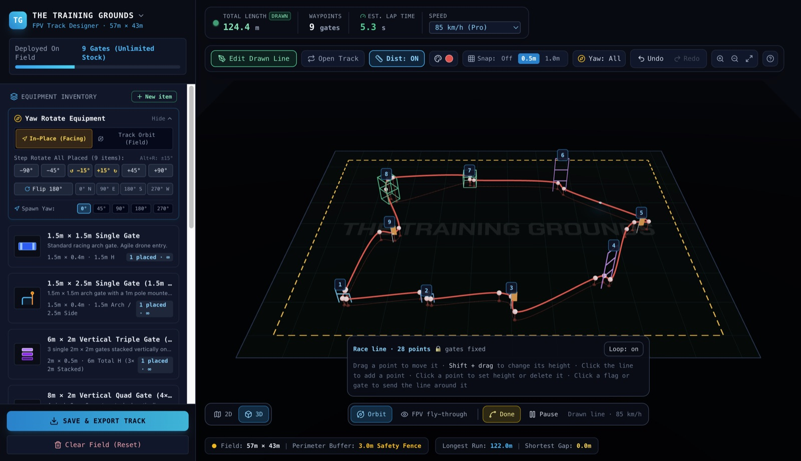
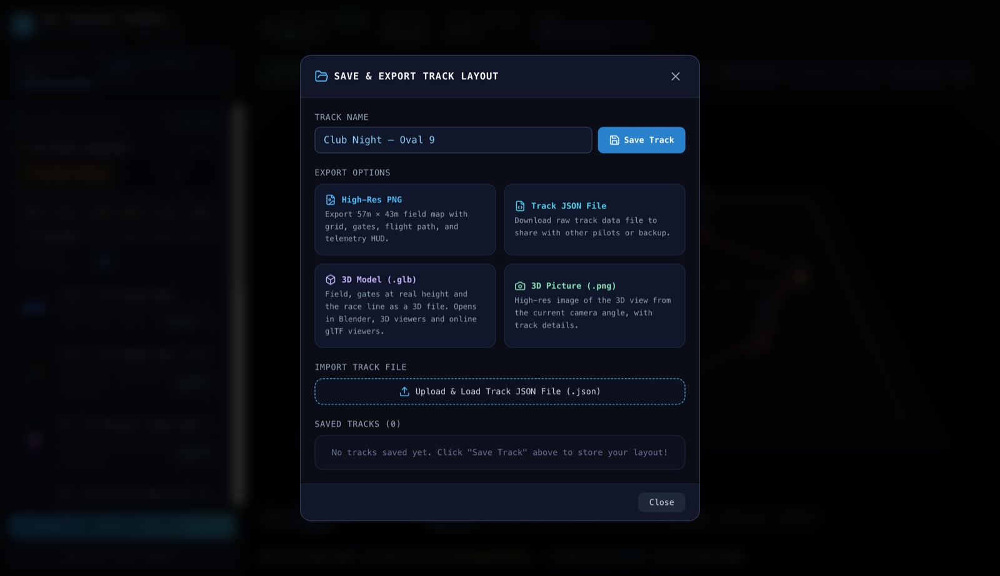
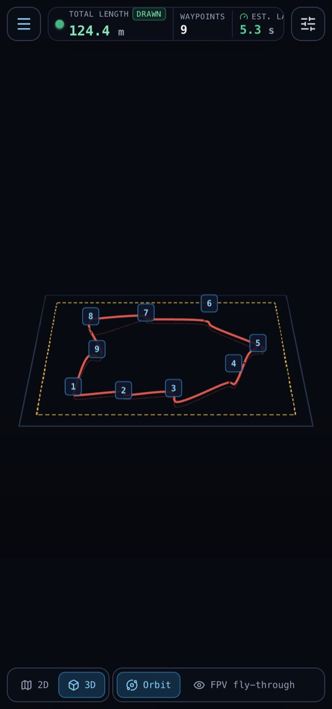
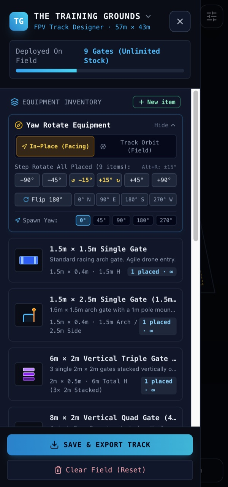
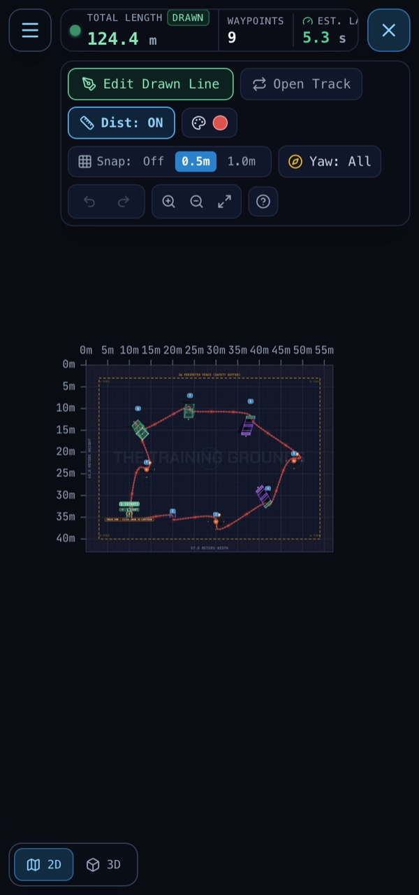
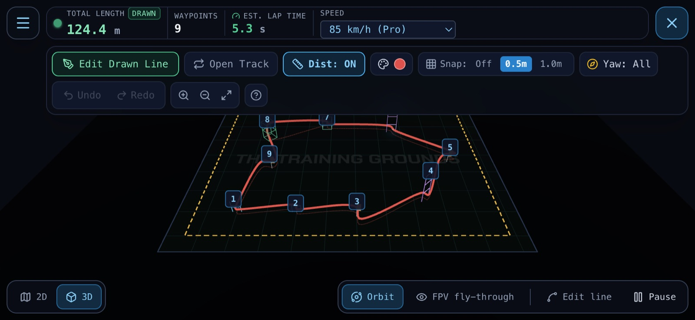

<p align="center"></p>

# 🏁 The Training Grounds

**Design an FPV drone racing track, draw the race line, and fly through it in 3D before a single gate leaves the van.**

Place real gates and flags on a field drawn to scale, see the distance between every gate, get a lap-time estimate, and share the finished layout with your club as one small file. It works on your phone at the field and on your laptop at home.

Free for pilots & clubs · Android · Windows · macOS · works offline

---

## ⬇️ Download

| Your device | Download | Notes |
|---|---|---|
| 🤖 **Android** (phone / tablet) | [**TrainingGrounds-Android.apk**](https://github.com/abhjz/the-training-grounds/releases/latest/download/TrainingGrounds-Android.apk) | Android 7 or newer |
| 🪟 **Windows** — installer | [**TrainingGrounds-Windows-Setup.exe**](https://github.com/abhjz/the-training-grounds/releases/latest/download/TrainingGrounds-Windows-Setup.exe) | Windows 10 / 11, 64-bit. Adds a Start-menu shortcut |
| 🪟 **Windows** — portable | [**TrainingGrounds-Windows-Portable.exe**](https://github.com/abhjz/the-training-grounds/releases/latest/download/TrainingGrounds-Windows-Portable.exe) | No install — run it from anywhere, even a USB stick |
| 🍎 **Mac** — Apple Silicon (M1–M4) | [**TrainingGrounds-Mac-AppleSilicon.dmg**](https://github.com/abhjz/the-training-grounds/releases/latest/download/TrainingGrounds-Mac-AppleSilicon.dmg) | macOS 12 or newer |
| 🍎 **Mac** — Intel | [**TrainingGrounds-Mac-Intel.dmg**](https://github.com/abhjz/the-training-grounds/releases/latest/download/TrainingGrounds-Mac-Intel.dmg) | macOS 12 or newer |
| 📱 iPhone / iPad | — | Not available yet |

All versions and release notes: **[Releases](https://github.com/abhjz/the-training-grounds/releases)** · [Check your download is genuine](#-check-your-download-is-genuine)

> **Which Mac do I have?** Apple menu  → **About This Mac**. "Chip: Apple M…" → Apple Silicon. "Processor: Intel" → Intel.

---

## 📸 A look inside

<p align="center"></p>

| 🗺️ 2D editor — exact metres, every gap measured | 🎥 FPV fly-through — see it from the quad |
|:--:|:--:|
|  |  |
| ✏️ **Race line editor** — shape the line in 3D, gates stay put | 💾 **Save & share** — name it, export it, send it |
|  |  |

### 📱 Made for the phone too

| 3D field | Equipment drawer | 2D + tools | Landscape |
|:--:|:--:|:--:|:--:|
|  |  |  |  |

---

## ✨ Features

### 🗺️ Build the track
- **A field drawn to scale.** The default is 57 × 43 m with a 3 m safety fence, and you can add your own grounds from 15 m up to 300 m. Each ground keeps its own layout.
- **Real equipment.** Pick from 1.5 m single gates, arch gates with a side pole, 2 m cube gates, double cubes, vertical triple and quad ladders, and 3 m flag poles. Stock is unlimited.
- **Your own equipment.** Use **＋ New item** to add any gate or obstacle you own with its real size.
- **Placing pieces.** Tap the field to place, drag to move, and snap to 0.5 m or 1 m.
- **Rotating pieces.** Yaw in 15° steps, pitch and roll, mirror, and set the angle new pieces spawn at. You can rotate every piece at once, either in place or around the field.
- **Locking.** Lock a piece so it can't be moved by accident.
- **Ready-made layouts.** Start from a pro preset: Championship Qualifier, High-Speed Sweeper & Slalom, or Precision Cube & Technical Loop.

### 🛤️ Plan the line
- **Gate order.** Number the gates and the path joins them in sequence, with the distance of every leg shown.
- **Draw the line yourself.** Use **Draw Track Line** to trace your own line with your finger or mouse, then smooth it or build a curve through the gates automatically.
- **Circuit or open track.** Loop back to the start, or finish at the last gate.
- **Maneuvers on every gate.** Mark corkscrews, slaloms, dives, Split-S, ladders up and down, or orbiting a pole and exiting.
- **Race line editor in 3D.** Drag points, **Shift + drag** to change height, and click a flag or gate to send the line around or through it. Gates stay fixed while you edit, so a stray tap can't move them.

### ⏱️ Know the numbers
- **Live figures.** Total length, gate count, longest straight and shortest gap update as you work.
- **Lap-time estimate.** Choose a speed: **25** (Training), **60**, **85**, **100** or **120 km/h**.

### 🎥 See it before you build it
- **3D field.** Orbit around the layout with gates at their real heights.
- **FPV fly-through.** Ride the line at your chosen speed, from the quad's point of view.

### 💾 Save, share, export
- **Saved tracks.** Name a track and save it. It **remembers the field size**, so it always reopens on the right ground.
- **Track file (.json).** Send it to other pilots and open it on any phone or computer. On Android you can tap a track file in WhatsApp or Files and choose **Open with Training Grounds**.
- **High-res field map (.png).** A top-down plan with grid, gates, path and stats, ready for a briefing or a printout.
- **3D model (.glb).** The field, gates and race line, which open in Blender and any glTF viewer.
- **3D picture (.png).** The 3D view from your current camera angle.
- **Undo / redo and autosave.** Your work is kept even if you close the app.

### 📱 Works where you are
- **Phones and tablets.** The equipment panel becomes a slide-in drawer and the tools fold into one button. Pinch to zoom and two-finger drag to pan in 2D.
- **Desktop.** You get the full layout plus keyboard shortcuts. Click the **?** button in the toolbar to see them.
- **No internet needed.** Everything stays on your device, with no accounts and no tracking.

---

## 🚀 Install

<details>
<summary><b>🤖 Android</b></summary>

1. Download **TrainingGrounds-Android.apk** on your phone, or send it to yourself by WhatsApp, Drive or email.
2. Tap the file. If Android asks, allow **Install unknown apps** for the app you opened it with (Files, Chrome, Drive…).
3. Tap **Install**, then open **Training Grounds**.

To update, install the new APK over the old one. Your saved tracks stay.
</details>

<details>
<summary><b>🪟 Windows</b></summary>

1. Download the **Setup** (installs with a Start-menu shortcut) or the **Portable** version (no install).
2. Run it. Windows may show **"Windows protected your PC"** because the app isn't code-signed yet. Click **More info → Run anyway**. This only happens the first time.
</details>

<details>
<summary><b>🍎 macOS</b></summary>

1. Download the **.dmg** for your Mac (Apple Silicon or Intel), open it and drag **Training Grounds** to **Applications**.
2. The app isn't notarized by Apple yet, so the first time macOS will block it:
   - Try to open it once, then go to **System Settings → Privacy & Security** and click **Open Anyway**.
   - If macOS says the app **"is damaged"**, run this once in Terminal (it only removes the download flag):
     ```bash
     xattr -cr "/Applications/Training Grounds.app"
     ```
</details>

### 🔐 Check your download is genuine

Every release lists a **SHA-256 checksum** for each file (in the release notes and in `SHA256SUMS.txt`). If your file's checksum matches, it's exactly the file published here and nobody has changed it.

- **Mac:** open Terminal and run `shasum -a 256 ~/Downloads/TrainingGrounds-Mac-AppleSilicon.dmg`
- **Windows:** open PowerShell and run `Get-FileHash $HOME\Downloads\TrainingGrounds-Windows-Setup.exe`
- **Android:** every official APK is signed with the same certificate. Its SHA-256 fingerprint is
  `49:45:F3:FC:DD:82:A8:96:BF:FD:5A:2D:9C:9F:3D:B7:EE:55:A1:F9:1D:B1:7F:2D:DE:48:73:FA:66:6C:C2:C8`

Only download the apps from this page. Copies posted anywhere else may have been changed.

---

## 🔄 Moving tracks between devices

1. Open **☰ → Save & Export Track → Track JSON File**. On a phone this opens the share sheet; on a computer it saves the file.
2. Send the file any way you like: WhatsApp, AirDrop, email, USB or Drive.
3. On the other device, open **Save & Export Track → Upload & Load Track JSON File**, or on Android just tap the file and choose **Training Grounds**.

The track arrives at the same size it was designed on. If that device doesn't have a field that size yet, the app creates it.

---

## 🛠️ For developers

The app is written in React + TypeScript with Vite, Tailwind CSS and three.js (react-three-fiber). It's packaged with **Capacitor** for Android and **Electron** for Windows and macOS.

```bash
npm install
npm run dev          # web version at http://localhost:3000
npm run build        # production web build in dist/
```

| Build | Command | Needs |
|---|---|---|
| Android APK | `npm run build && npx cap sync android && cd android && ./gradlew assembleRelease` | JDK 21 + Android SDK. Release signing needs your own key in `~/TrainingGrounds-Signing/keystore.properties`; without one the APK is built unsigned |
| Windows | `npm run dist:win` | — (builds on macOS too) |
| macOS | `npm run dist:mac` | a Mac |
| Desktop dev run | `npm run desktop:start` | — |

```
src/            the app (components, 2D canvas renderer, 3D field, track maths)
android/        Capacitor Android project (+ TrackFilePlugin for "Open with")
desktop/        Electron shell for Windows / macOS
ios/            Capacitor iOS project (not released yet)
docs/images/    README pictures
```

Ideas, bugs and pull requests are welcome. Please [open an issue](https://github.com/abhjz/the-training-grounds/issues).

## 📜 License

**[PolyForm Noncommercial 1.0.0](LICENSE.md)** — free for **noncommercial** use.

| ✅ Allowed, free | ❌ Needs written permission |
|---|---|
| Pilots using it to plan, practise and race | Selling the app or a modified version |
| Non-profit clubs, schools, charities and public bodies | Paid or commercial products and services built on it |
| Studying, changing and sharing the code for noncommercial use | Rebranding it to sell, or bundling it with something you sell |

Want to use it commercially? [Open an issue](https://github.com/abhjz/the-training-grounds/issues) to ask.

Copyright © 2026 abhjz. Pilots and race directors are responsible for real-world safety; lap times and fence distances are planning estimates.
