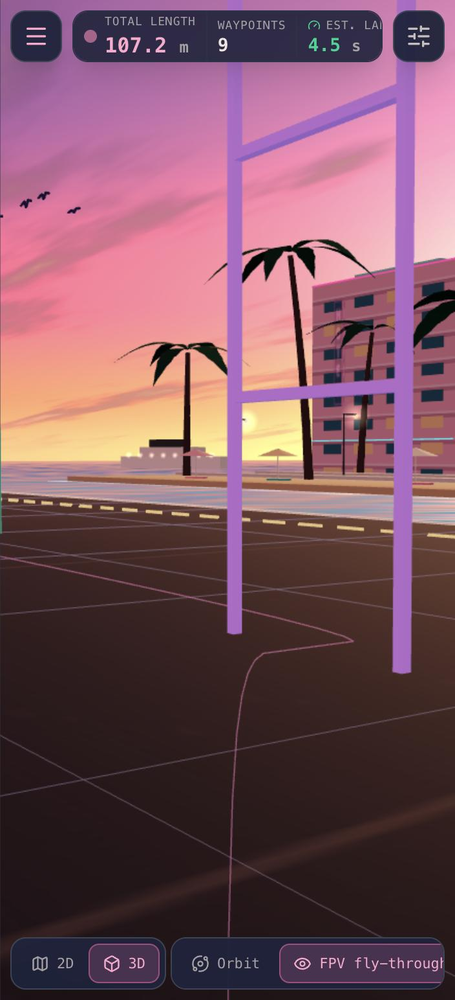

# Coastal Sunset look

The theme lives in [`src/theme/coastalSunset.ts`](../src/theme/coastalSunset.ts). Change its tokens to update the colour palette, field, 2D map, 3D waterfront and motion values together. The picker and sidebar use its display name.

| Token group | Used by |
|---|---|
| `palette` | Normal-look colour theme and app controls |
| `look` | Look name; the saved look ID stays `sunset` |
| `ui` | Panels, browser colour, 2D water gradient |
| `field` | Race line, fence, labels, map and 3D ground |
| `scene` | Sky, sun, tarmac, palms, skyline and fog |
| `motion` | Palm sway, boats, birds and water drift |

The palette ID stays `vice-sunset` and the look ID stays `sunset` so saved choices continue to load. The scene is [`CoastalSunsetScene.tsx`](../src/components/CoastalSunsetScene.tsx); it is decorative and left out of 3D track exports. Motion follows the system's reduced-motion setting. On narrow screens the scene uses fewer buildings and palm leaves, one boat and a lower maximum pixel ratio.

## Visual direction

A tropical ocean drive at golden hour. The low sun sits behind the city over the sea; the sky runs from gold at the horizon through coral and hot pink to violet and deep blue, with long stratus clouds lit from below. The water is turquoise near the pad and the beach, deeper out at sea, with a sun-glitter path and foam along the shore.

Behind the pad: a beach with umbrellas, a palm-lined drive with street lamps and cruising cars, pastel art deco hotels with rounded corners, neon trim and signs, and glass towers reflecting the sunset. Speedboats with wakes, an anchored yacht, a circling helicopter and birds keep the scene moving. Everything is drawn in code in this project.

The race field stays dark with a pink neon rim, so gates and the flight path stay easy to read.
